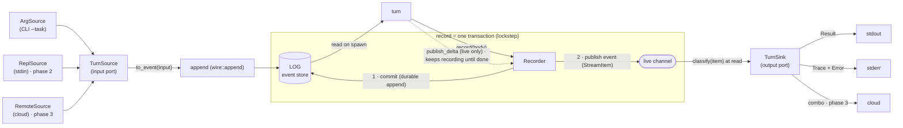
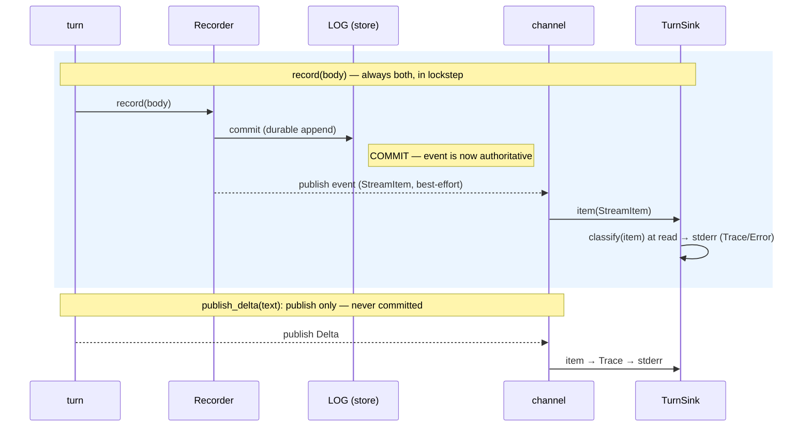

# Turn I/O ports — diagrams

Companion to [`2026-06-13-stream-output-sink.md`](./2026-06-13-stream-output-sink.md).

## 1. Ports & adapters around the log store

The log is the hub. Input adapters feed the input port; the turn reads the store;
the turn's emissions go through one **record transaction** — `commit` to the log
then `publish` the event to the channel; sinks `classify` it at read time (in lockstep).

## 2. The record transaction (sequence)

`record` = commit then publish, in lockstep. The durable append is the commit;
the channel publish is an at-least-once projection of the committed event,
carrying its class. One call, so the log and the live sinks never diverge —
except deltas, which go through `publish_delta` (publish only, never committed).

## 3. The unified run loop (CLI and REPL converge)

Both `cmd_run` and the REPL become the same loop; only the adapter pair differs.

