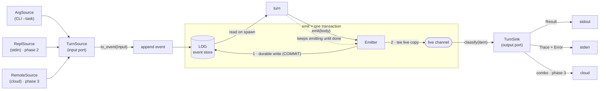
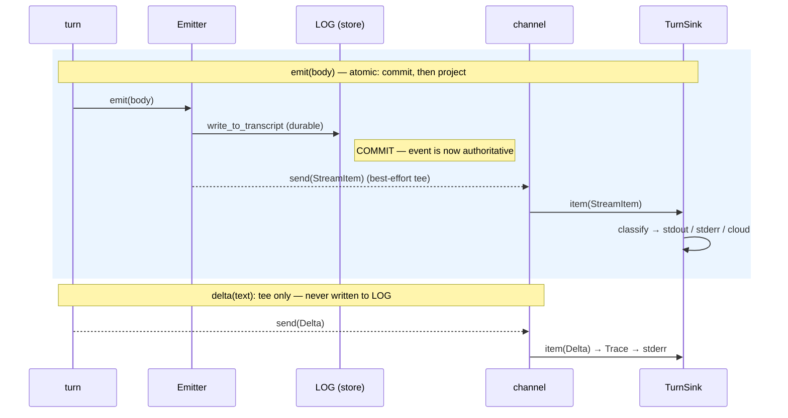
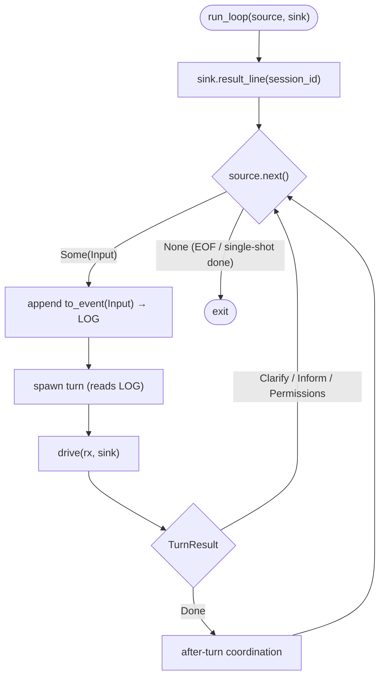

# Turn I/O ports — diagrams

Companion to [`2026-06-13-stream-output-sink.md`](./2026-06-13-stream-output-sink.md).

## 1. Ports & adapters around the log store

The log is the hub. Input adapters feed the input port; the turn reads the store;
the turn's emissions go through one **emit transaction** that commits to the log
and tees a live copy to the output sinks.

## 2. The emit transaction (sequence)

The durable append is the commit; the channel tee is an at-least-once projection
derived from the committed event. They are one call so the log and the live
sinks never diverge — except deltas, which are tee-only and never logged.

## 3. The unified run loop (CLI and REPL converge)

Both `cmd_run` and the REPL become the same loop; only the adapter pair differs.

